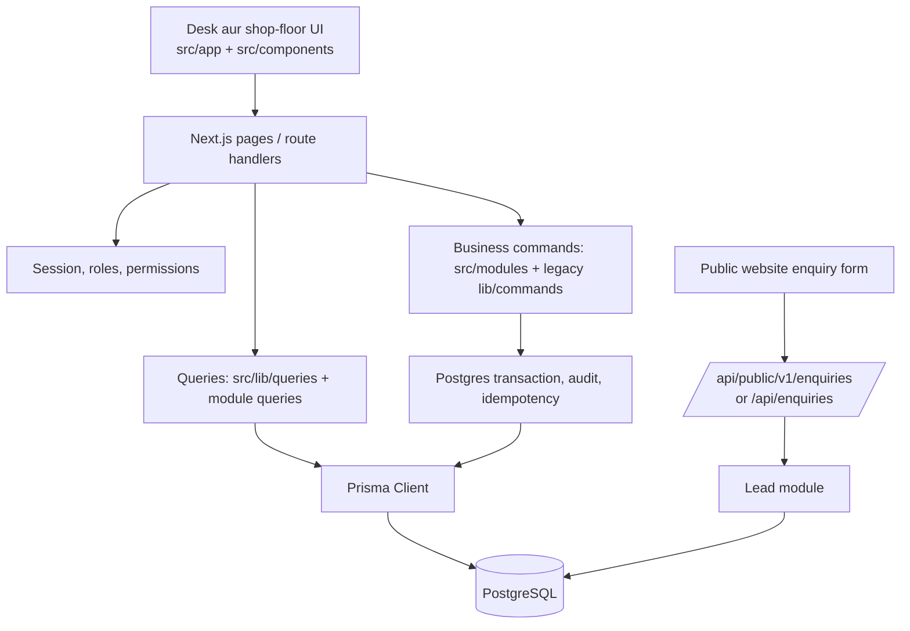

# SS-Steel-Flow Project Guide (Hinglish)

> **Yeh project kya hai?**
>
> Yeh repository SS Metals ke plant ke liye ek **steel manufacturing ERP** hai. Iska main kaam sales enquiries/orders ko purchase, stock, production jobs, quality checks aur dispatch ke saath jodna hai. Is repo ka primary app Next.js + React + TypeScript par hai; data PostgreSQL mein hai aur Prisma us data ko access karta hai.
>
> Yeh guide source code aur config ko padhkar banayi gayi hai. Is scan mein app server ya live database ko run/check nahi kiya gaya, isliye yeh code ke current design ko batati hai, live environment ke current records ko nahi.

## Ek nazar mein architecture

Request ka aam flow:

1. Page (src/app) data server side load karti hai, ya user interaction ke liye client component dikhati hai.
2. Form/action client se /api/... endpoint ko request bhejti hai.
3. Route handler input validate karta hai, session/permission check karta hai, phir domain command call karta hai.
4. Command Prisma transaction mein related rows update karta hai. Stock change ho to balance ke saath stock ledger bhi update hota hai.
5. Successful response ke baad UI router refresh ya redirect karti hai.

## App ke do operational areas

- **Desk:** Admin, sales, purchase, supervisor aur QC staff ke liye. Iska shared frame DeskShell hai: sidebar, topbar, notification bell aur mobile tabs.
- **Shop floor:** Operator aur shop QC ke liye. /shop ke neeche assigned jobs, job execution, material requests, history, alerts aur QC queue hain. Shop aur desk alag layouts use karte hain, par shared shell/components use hote hain.
- **Login ke baad landing:** / session check karke homeFor(session) ke hisaab se user ko bhejta hai. Logged-out user /login par jata hai. Sirf job execute karne wale operator desk ke bajay /shop par bheje jate hain.
- **Menu access:** deskNavForSession / shopNavForSession permissions aur roles ke hisaab se sidebar items filter karte hain. Page/API ke andar alag authorization checks bhi hain; sidebar hide hona security boundary nahi hai.

### Screens/routes ka map

Parentheses wale Next.js folders jaise (desk), (shop), (auth) route groups hain; unke naam URL mein nahi aate.

| URL area | User yahan kya karta hai |
|---|---|
| /login, /access-denied | Sign in aur access error |
| /dashboard, /notifications | Plant overview aur alerts |
| /leads, /sales | Enquiries process karna, sales orders manage karna |
| /purchase-orders, /requisitions, /receipts, /suppliers | Supplier procurement aur incoming stock receive karna |
| /inventory, /inventory/ledger, /inventory/transfer, /inventory/adjust, /inventory/batches/[id] | Stock dekhna, movement audit, transfer/adjustment aur batch trace |
| /products, /products/catalog, /categories, /designations | Product/material master aur organization setup |
| /production, /jobs, /job-approvals | Production orders, operation board aur approvals |
| /quality, /dispatch, /maintenance | Inspections, shipments aur machine breakdowns |
| /users, /employees, /roles, /settings | Accounts, staff, permissions aur plant configuration |
| /shop, /shop/jobs, /shop/requests, /shop/history, /shop/alerts, /shop/qc | Operator/QC mobile-friendly workflows |
| /api/v1/... | UI aur integrations ke authenticated data/action endpoints |
| /api/public/v1/enquiries, /api/enquiries | Public website se enquiry intake |

## Main business flow: enquiry se dispatch tak

### 1. Website enquiry aur sales lead

Website se enquiry do API paths par aa sakti hai:

- POST /api/public/v1/enquiries: structured public enquiry schema use karta hai.
- POST /api/enquiries: website ke existing payload ko internal lead format mein map karta hai.

Dono src/modules/leads/public-enquiry.ts ke createWebsiteLead() par aate hain. Yeh plant resolve karta hai, duplicate/rate limits lagata hai, Lead + LeadItem + history/activity save karta hai aur desk users ke liye notification queue karta hai. Email config maujood ho to customer confirmation email bhi ja sakti hai. Desk par /leads se team lead ko assign, verify, status-update aur sales order mein convert kar sakti hai.

### 2. Sales order aur material planning

Sales order /sales se manage hota hai (src/modules/sales/commands.ts). Approval ke baad BOM ke basis par material requirements nikalti hain. src/modules/planning/mrp.ts quantity, scrap/loss aur stock pool ko mila kar net procurement need calculate karta hai. reservations.ts aur link-job-material.ts stock/job ke links aur reservations sambhalte hain.

### 3. Purchasing aur receiving

Requirement se requisition ban sakti hai, phir purchase order create/submit/approve/send hota hai (src/modules/procurement/). Goods receipt par received coil/batch aur incoming QC inspection banti hai. Receipt post hone par accepted material pehle QC-hold bucket mein aa sakta hai; inspection pass/decision ke baad usable stock available hota hai. Rejected quantity alag track hoti hai.

### 4. Production aur job routing

Sales line ke liye src/modules/production/from-sales.ts production order banata hai. Active routing ki har operation ke liye JobCard banti hai; JobDependency predecessor/successor order enforce karta hai. Supervisor jobs assign karta hai, operator /shop/jobs se start/progress/pause/submit karta hai, aur QC inspection ke baad authorized supervisor approval deta hai. Har stage permissions aur job state checks se gated hai.

QC-approved output aage wali operation ko release ho sakta hai (production/advance-routing.ts). Aakhri operation complete hone par sales line ki produced quantity update hoti hai; order ki sabhi lines poori hon to status ready_for_dispatch banta hai (sales/production-sync.ts).

### 5. Inventory, quality aur dispatch

Inventory ka stock bucket balance StockBalance mein rakha hai—available, reserved, QC hold, WIP, finished, scrap aur rejected categories ke saath. Har movement postMovement() se post hota hai aur StockLedger mein record rehta hai. Batch genealogy BatchLink se parent coil aur child output ko jodti hai. Dispatch finished stock ko shipment ke roop mein record karta hai.

README ka demo “golden path” isi chain ko detail mein dikhata hai: PO → receipt/QC → production release → operator job → in-process QC/approval → final QC → finished goods dispatch. Pehla operation approve hone se pehle successor job locked rehta hai.

## Kaun sa code kis zimmedari mein hai?

| Location | Role |
|---|---|
| src/app/(desk)/ | Desk screens: dashboard, leads, sales, inventory, purchase, production, jobs, QC, dispatch, reports, users/settings |
| src/app/(shop)/shop/ | Shop-floor home, jobs, material request, history, alerts aur QC screens |
| src/app/(auth)/ | Login aur access-denied screens |
| src/app/api/v1/ | Authenticated JSON APIs: users, sales, procurement, stock, jobs, production, QC, reports, etc. |
| src/app/api/public/ and src/app/api/enquiries/ | Public website enquiry ingestion endpoints |
| src/components/ | Reusable UI, shell/sidebar, forms, tables aur interaction hooks |
| src/modules/ | Domain logic, jo feature ke hisaab se group ki gayi hai |
| src/lib/queries.ts | Read/query functions ka bada shared collection; dashboards, stock, jobs aur masters ke liye data reads |
| src/lib/commands.ts | Purana/shared command module; job lifecycle, QC, dispatch, employee/user jaise kuch flows abhi yahin hain |
| src/lib/inventory/post.ts | Transaction wrapper, idempotency, stock movements, number sequences, audit aur notifications |
| src/lib/auth/, src/lib/rbac/ | Session, password helpers, roles/permissions aur authorization |
| prisma/schema.prisma | Relational data model |
| prisma/migrations/ | Database schema evolution ka ordered history |
| prisma/seed.ts | Demo plants, roles, users, materials, BOM/routing aur initial data seed karta hai |

### Domain modules

- leads/: public/manual enquiries, lead status, activity, conversion aur customer notifications.
- sales/: sales orders, status changes aur production ke saath sync.
- planning/: BOM explosion, stock pools, reservations aur job-material linking.
- procurement/: requisitions, purchase orders aur goods receipts.
- production/: sales se production order/job routing, routing progression aur job events.
- masters/ + bom/: categories, catalog/material masters aur BOM.
- material-requests/: shop-floor shortages ko desk review se jodta hai.
- reports/: report-specific aggregated read queries.
- rbac/: role/designation command logic.
- inventory/: demo stock seeding; actual stock posting shared src/lib/inventory/post.ts mein.

Project ek **modular monolith** hai: modules code mein alag hain, par sab ek Next.js app aur ek PostgreSQL database ke andar hain. Modularization complete nahi hui—src/modules/README.md bhi batata hai ki core jobs, quality aur dispatch abhi legacy src/lib/commands.ts mein hain.

## Data model ka high-level map

prisma/schema.prisma mein business entities relational tables ke roop mein hain. Central links kuch is tarah hain:

- User ↔ Role ↔ Permission, aur UserPlantAccess se user plant-scoped hota hai.
- Plant ke andar warehouse/location, employees, suppliers, materials, machines, shifts aur orders hain.
- Customer → Lead → SalesOrder → SalesOrderItem → ProductionOrder → JobCard.
- Product/ProductVariant + BomHeader/BomItem + RoutingHeader/RoutingOperation production definition dete hain.
- PurchaseOrder → GoodsReceipt → MaterialBatch → QcInspection incoming material ko stock mein lane ka flow hai.
- MaterialBatch + StockBalance current quantities dikhate hain; StockLedger movement history hai; BatchLink batch genealogy hai.
- Shipment/ShipmentItem dispatch, AuditEvent change history, Notification/Outbox internal delivery aur IdempotencyKey repeat POST se protection mein madad karte hain.
- Leads ke liye alag status history, activity aur public submission/deduplication records hain.

## API, permissions aur data integrity

- Session cookie ka naam ss_session hai. DB mein raw token ke bajay token hash stored hota hai; session idle/expiry check getSession() mein hota hai.
- API route Zod schema se body validate kar sakta hai, same-origin POST check karta hai, requirePermission() se permission enforce karta hai, phir command call hoti hai.
- usePost() client hook JSON POST bhejta hai, idempotency key bhejta hai, success/error dikhata hai, aur zarurat par route refresh/redirect karta hai.
- Mutating commands runCommand() ke andar transaction chalate hain; same user/route/key ka repeat request purana response de sakta hai. Stock movement, audit aur related event ko saath commit karne ka pattern yahin se aata hai.
- assertPlant/plant-scoped queries ensure karte hain ki session ke allowed plants ke bahar ka data na badle.
- Business side effects ke liye in-app notification aur email outbox use hota hai; scripts/deliver-notifications.ts pending customer notification delivery ke liye available hai.

## Database aur setup

Stack/config se jo dikh raha hai:

- Next.js 16.4.0, React 19.3.0, TypeScript, Tailwind CSS 4, Prisma 6.19.3, PostgreSQL.
- .env.example mein DATABASE_URL, admin/demo seed credentials, public lead plant code, SMTP aur optional cron secret ke variable names diye hain. Actual .env values iss guide mein jaan-boojhkar include nahi ki gayi hain.
- Local setup README ke mutabik: PostgreSQL start → .env configure → npm install → npx prisma migrate deploy → npm run db:seed → npm run dev.
- Seed code do demo plants banata hai. Admin account email/password environment se aate hain; baaki demo users DEMO_USER_PASSWORD se seed hote hain.
- Migrations ki history init se sales/MRP, masters, RBAC, catalog, leads aur purchase receipt workflow tak badhi hai. Schema change ke baad generated Prisma client ke liye npm run db:generate hai.

Useful scripts: npm run dev, npm run build, npm run start, npm run lint, npm test, npm run test:integration, npm run db:deploy, npm run db:seed, npm run db:seed-stock, npm run jobs:deliver-notifications.

npm test currently kuch targeted unit tests chalata hai (stock buckets, MRP, procurement domain); integration suite alag npm run test:integration se chalti hai. Is guide banate waqt tests run nahi kiye gaye.

## Repo scan se dikhe current points

1. **Root repo ERP app hai.** Sidebar ka “SS METALS” brand text external https://ss-metals-ruby.vercel.app/ ko new tab mein kholta hai. Yeh link src/components/desk-sidebar.tsx mein hai.
2. **Website ka enquiry connection code mein maujood hai.** Public endpoints website payload ko ERP ke Lead records mein badalte hain. Website UI itself is repository ke root src/app ke andar nahi dikhi; link deployed external site par hai.
3. **dev:website script ka path check karna chahiye.** package.json mein yeh SS-Metal -website subfolder ke liye likha hai, lekin root folder listing mein woh directory nahi thi. Isliye checked checkout mein script target missing lagta hai.
4. **Business logic ka split transitional hai.** Naye areas src/modules/ mein hain, par src/lib/commands.ts abhi bhi bahut bada central module hai. Kisi feature ko badalte waqt pehle check karein ki uska naya module bana hai ya legacy command hi source of truth hai.
5. **README.md local setup aur demo flow batata hai**, par deployed DB/server ke actual state ka proof nahi deta. Production environment ya database inspect kiye bina live status conclude nahi kiya ja sakta.

## Naye developer ke liye reading order

1. README.md aur yeh guide: product workflow aur local setup samajhne ke liye.
2. src/app/(desk)/layout.tsx, src/app/(shop)/shop/layout.tsx, src/components/desk-shell.tsx: login guard aur shared UI frame.
3. src/lib/auth/session.ts, src/lib/rbac/authz.ts, src/lib/access.ts: request kaun kar sakta hai aur kis plant ke liye.
4. Kisi feature ka page → uska src/app/api/.../route.ts → module command/query → related Prisma models follow karein.
5. src/lib/inventory/post.ts + prisma/schema.prisma: transaction, stock history aur core entities.
6. prisma/migrations/ aur focused tests: schema/business rules ke evolution ko confirm karne ke liye.

